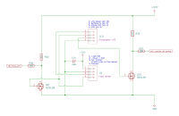
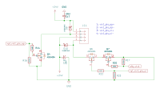

# Safety

## Software safety

This section describes software-safety built-ins.
These safeties are generally implemented as alarms,
i.e., they will notify the user in case something fails.
The alarm will generally (1) display an error message
and (2) sound the built-in buzzer.

Once the user clicks "Close" on the alarm message,
the buzzer will be cancelled and the safety stays deactivated for five minutes.
After this time has elapsed and the safety is still of importance,
it will be reactivated.
The alarm will not occur again unless (1) something actually happens again or
(2) the user has not fixed the issue.

> [!TIP]
> The "Settings" screen contains a button that can be used to enable a test-alarm.
> This alarm will be cancelled and will not recur after the "Close" button is pressed.
> It simply serves to demonstrate the buzzer sound to a new user.

### Sample safety

If the cryocooler is on and samples are stored in the UI,
we assume that samples are loaded that should stay cold.
In this case, whenever the instruments are polled
(which is approximately every three seconds),
the host software will check the following conditions:

- Is the water flow okay (and thus by proxy the cryocooler)?
- Is the ion pump on?
- Is the pump stand on?
- Is the current sample temperature larger than 130 Kelvin?

If any of these conditions are not met, an alarm is raised.
This will inform the user that an issue has occurred that should be checked.

> [!NOTE]
> If an alarm occurs but fixes itself, i.e., an instrument returns a bad read
> but the next time around recovers itself,
> The alarm is cancelled.
> However, a log entry will be written out.
> This is especially useful as the Lakeshore temperature controller
> tends to hang every few months.

> [!TIP]
> The minimum sample temperature can be set in the UI configuration.
> See [the GUI section](./gui.md) for more details.

## Hardware safety

This section describes the hardware-side safeties
that were implemented for the cryostorage chamber.
These safeties are as far as possible implemented in the circuit design,
meaning that they do not require firmware or software to properly work.
Caveats to these limitations are discussed below.

### Cryocooler safety

The cryocooler must not be run when there is no or insufficient cooling water.
Thus, not allowing the cryocooler to start when powering it up and ensuring
it powers down when cooling water is lost is crucial.

The cryocooler itself has two modes of operation:

- Computer control mode.
- Control via a digital input pin (so-called soft-stop mode).

If controlled via the digital input pin, the cryocooler runs
as long as this input line is grounded, i.e., at 0V.
If the input line is pulled up to 5V,
the cryocooler enters the soft-stop mode and comes to halt.

Above figure shows the wiring diagram for the cryocooler safety.
The following symbols are important in below discussion:

- J9: Connector to the flow meter.
- J10: Connector to the cryocooler.
- Q9: MOSFET for flow meter read line.
- Q10: MOSFET for cooler at temperature read line.

> [!NOTE]
> The "Cooler at temperature" read line
> is currently unused.

Here we use the 5V supplied by the cooler itself to activate the soft-stop.
This +5V cooler (J10, pin 1)
is connected to the soft-stop (J10, pin 2)
via the flow meter N.C. contacts (J9, pin 3 and 4).
If there is no flow or no power,
J9 pins 3 and 4 are connected to each other.
This will apply 5V to the soft-stop and thus stop the cooler.

> [!IMPORTANT]
> The 24 V power supply of the flow meter
> must be (and currently is) connected to the same power supply
> that powers the electronics.
> This will ensure that the cryocooler turns off if power is lost to the electronics.

Read out lines are connected via MOSFETS.
The lines trigger the MOSFET gates, which will then show high/low
on the input pins of the MCU.
Thus, the readout lines are isolated from the safety mechanism
via the MOSFET.

#### Caveat

Above described hardware safety depends on the cryocooler being set
to be controlled via the soft-stop mode.
This control-mode is set by the host software.

To turn the cryocooler on, the host software simply sets the control mode
to the soft-stop mode.
If the waterflow is okay and the electronics is powered,
this will pull the soft-stop pin 2 on J10 to ground
and thus turn the cryocooler on.

To turn the cryocooler off, the host software must do two things:

1. Set the control mode to computer control.
2. Turn off the cryocooler.

If an error occurs between step these two steps,
the cryocooler would now be on without being safety interlocked,
as the control mode is set to computer control
but the turn off signal has not been received.
If unnoticed and the waterflow measurements fail,
this could lead to cryocooler damage.

If setting the cryocooler state from the software fails,
an error is logged and an error message is displayed.
In the extremely unlikely case the error message cannot be displayed,
the program will crash as a last resort and thus inform the user
that something is wrong.
Since a running cryocooler is audible, we feel that these safety measures
are sufficient to ensure safe operations.

### Transfer valve closing safety

If the VCT is open and the valves are open,
it is possible for the VCT's transfer arm to be inside the chamber
and thus cross the cryostorage chambers transfer valve.
The here implemented safety ensures that the transfer valve cannot be closed
if a chance exists that the arm is in.

Unfortunately, we cannot directly access the state of the transfer arm
from interfacing with the VCT.
However, we can access the state of the two valves and see if they are open or closed,
details are given in the [VCT](./vct.md) section.

Above zoom in from the circuit diagram shows the relevant part for sending a
close-valve signal to the transfer valve.
The following components are important in the discussion below:

- J14: Connector to send open/close pulses to the transfer valve.
- Q6: MOSFET that sends the pulse.
- `rpi_vlv1_pls_cl`: 3.3V output pin from MCU to send a close pulse
  to the transfer valve.
- Q7: Safety MOSFET that prevents closing the valve if unsafe to do so.
- `sfty_vlv1`: Signal from VCT.

To close the valve, 24V must be applied betwene pin 3 and pin 4 on J14
for a certain amount of time.
In order for this pulse to actually applied,
MOSFETS Q6 and Q7 must be closed, i.e., must have 3.3V on the gate pin.
A user pressing the close button on the host software closes MOSFET Q6
for long enough to send the close pulse to the valve.

However, for this to be successful, MOSFET Q7 must also be closed.
This MOSFET's gate is directly connected to the VCT valve status signal.
If the gate valve of the VCT is open, the gate on MOSFET Q7 is at ground
and thus applying a voltage to MOSFET Q6 does not close the gate valve.
If the VCT gate valves are closed it is impossible for the arm
to reach across the transfer valve.
In this case (VCT detached) the gate on Q7 is at 3.3V
and thus the MOSFET is closed.
