# Workflows

## Abbreviations and notation

We use the following abbreviations for all flowcharts:

- pch: pressure in sample chamber.
- ptr: pressure in transfer system.

The following symbols are used to describe the workflow:

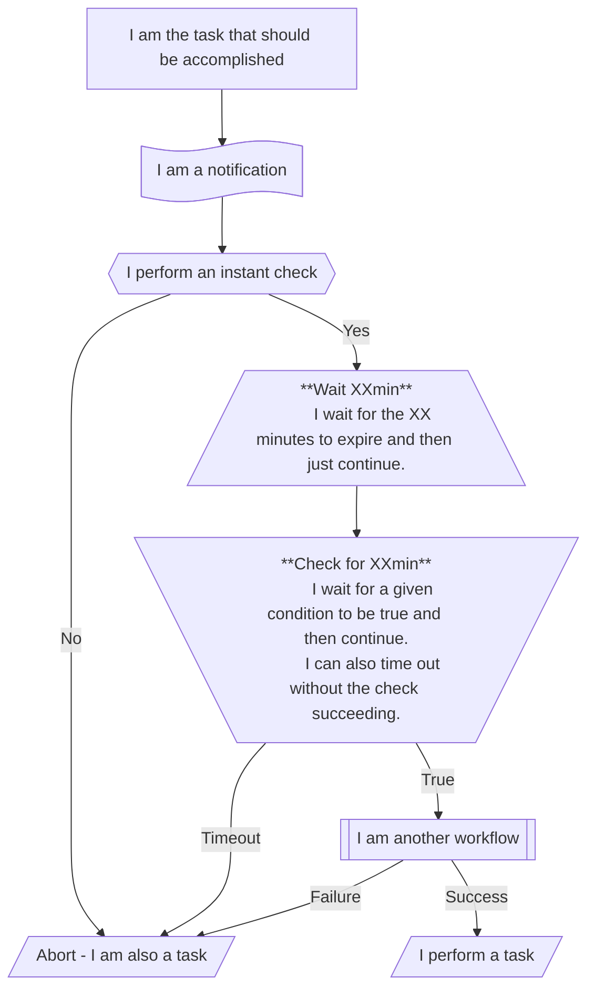

## Open valves

This authorization is implemented in software. It checks the last read pressures
and then goes through the following flowchart. Workflows that open valves go
through this authorization as well.

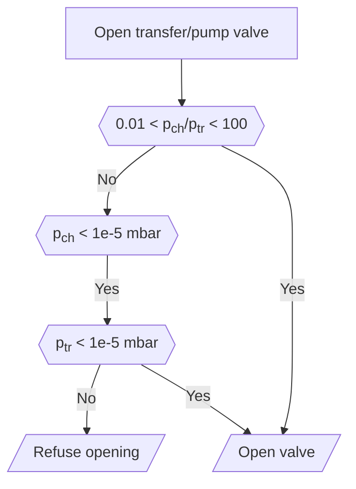

## Close valves

This authorization is implemented in software and in hardware on the controller
board (see [safety section](./safety.md)). Workflows that close valves go through
this workflow as well.

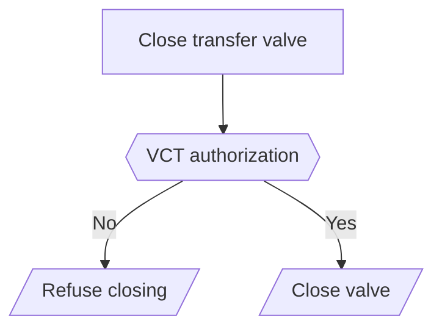

> [!NOTE]
> The pump valve can be closed without any checks.

## Cryocooler

Starting the cryocooler will start the cooler itself
as well as the "heater task".
This task will check the temperature every few seconds and,
if it is within the safe temperature band,,
start the heater of the Lakeshore temperature controller.
Since the cooler has too much power,
the heater will heat the sample to the set temperature.

### Start cryocooler

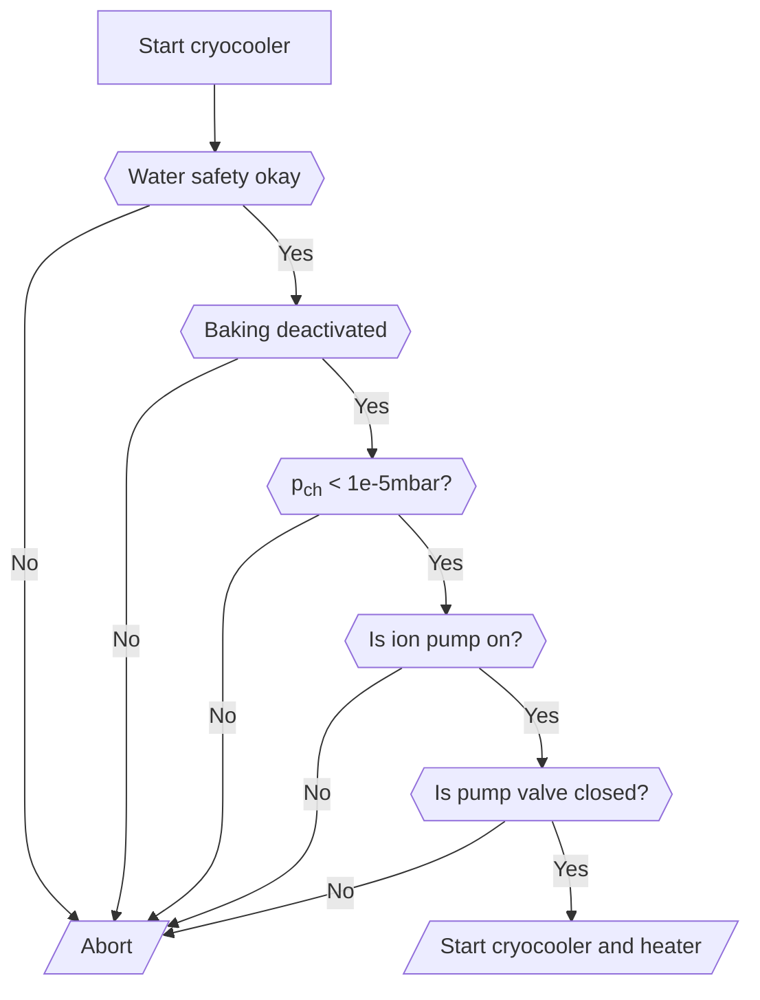

### Stop cryocooler

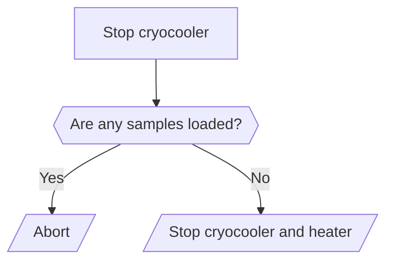

> [!NOTE]
> This workflow can of course only check if any samples are currently set
> in the graphical user interface.
> If samples are currently set, an error will be displayed.

## Start baking

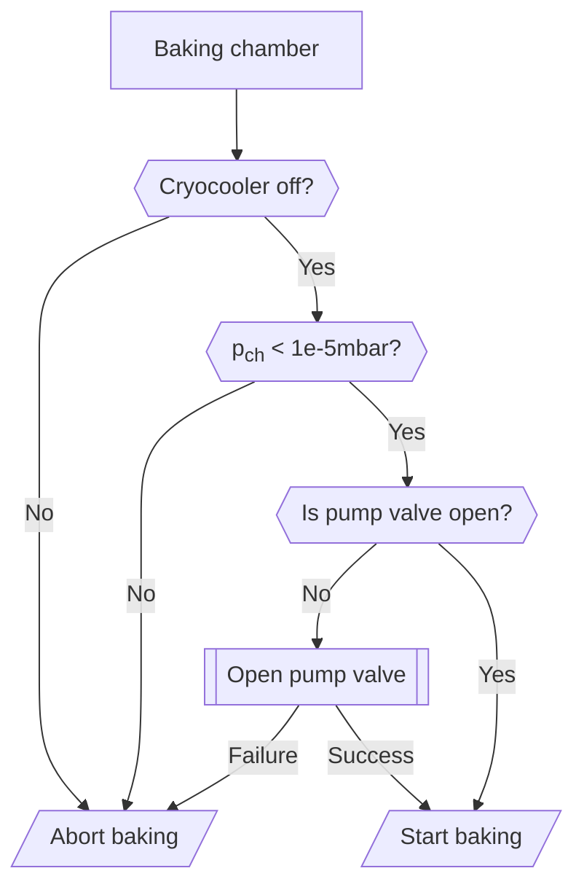

> [!NOTE]
> Baking can be stopped without any checks.

## Venting and pumping the system

Venting and pumping the system are two workflows that are fairly complicated.
In comparison with above simpler workflows, they compare multiple timers that can
check for a condition or just wait for the timer to expire.
Both main workflows are based on several sub workflows,
which are described further down.

> [!NOTE]
> **Pump valve authorization**
>
> These workflows do not use the workflow to open the pump valve.
> Instead, they open the pump valve directly if the authorization is there.
> Here, blocks with "Pump valve authorization" check for the same authorization
> as is the case in an open pump valve workflow.

### Vent cryostorage chamber

All variables can be specified and changed in the configuration file.
These variables are:

- Minimum sample temperature to continue.
- Wait time for opening the vent valve.

The limits that are given in the "No valve authorization" block
cannot be set.
These limits are taken from the definition of the valve opening authorization.

The user has the possibility to cancel the wait time at the end.
If this is chosen, the timer will simply stop early
and continue with the workflow,
i.e., it will close the vent valve.

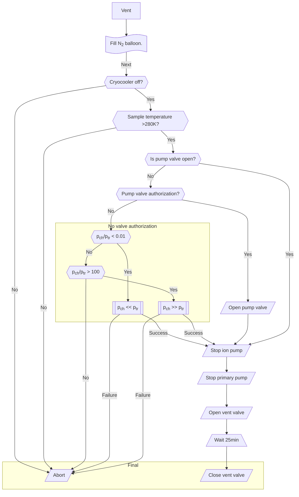

### Pump cryostorage chamber

The variables that can be adjusted in this workflow are three durations.

- Maximum time allowed for primary pump to pump the chamber
  down to <10-5mbar.
- Duration to wait before the ion pump is turned on.
  If this waiting time is canceled by the user, the workflow will finish
  but not turn on the ion pump.
- Duration to wait after ion pump turns on to close pump valve.

Again, as for the venting workflow, the pressure limits
to determine if we have pump valve opening authorization
are the same as the ones for valve authorization.

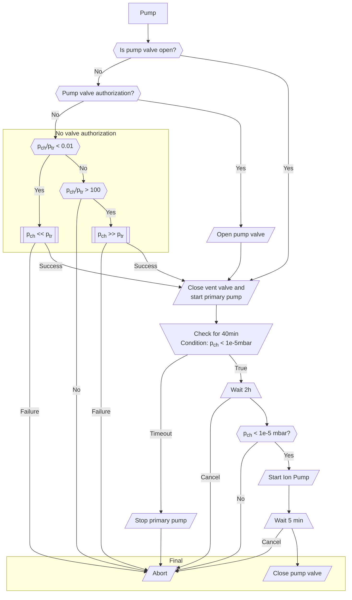

## Equalize chamber pressure

In the case where a valve cannot be opened,
these workflows to equalize the chamber pressure can be run.
These workflows are in fact important parts in the venting and pumping workflows.

### Chamber pressure low

If the chamber pressure is too low, i.e., if
\\[ \frac{p_\text{ch}}{p_\text{tr}} < 0.01, \\]
the transfer system must first be pumped before authorization
to open valves can be given.

The limits on the pressure checks that we fulfill in this flowchart
are again the same as for authorizing the pump valve to be opened.
The only configurable quantity is the timer,
which is in the flowchart set to 20 minutes.

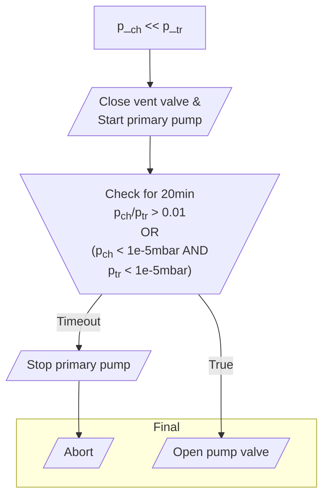

### Chamber pressure high

If the chamber pressure is too high, i.e., if
\\[ \frac{p_\text{ch}}{p_\text{tr}} > 100, \\]
the transfer system might be currently pumped and must first be vented.
Since venting is too fast,
this workflow first vents the transfer system
until ptr > pch.
It then jumps into the
"chamber pressure low" workflow.

Again, all pressure conditions in below flowchart
come from the open valve authorization.
The only adjustable setting is the timer.

Optionally, this workflow will display a message to the user
to fill the nitrogen balloon for venting.
This notification is only necessary if the workflow is called
from the "pump down" workflow.
In the "vent" workflow, this message has already been given before.

> [!NOTE]
> The first steps in the following diagram turn off both pumps.
> These might in fact not even run at the moment.
> However, turning them off sets their status to off, i.e.,
> this process does not toggle their state.
> Thus, setting these to off is valid when calling this workflow
> from pumping and from venting.

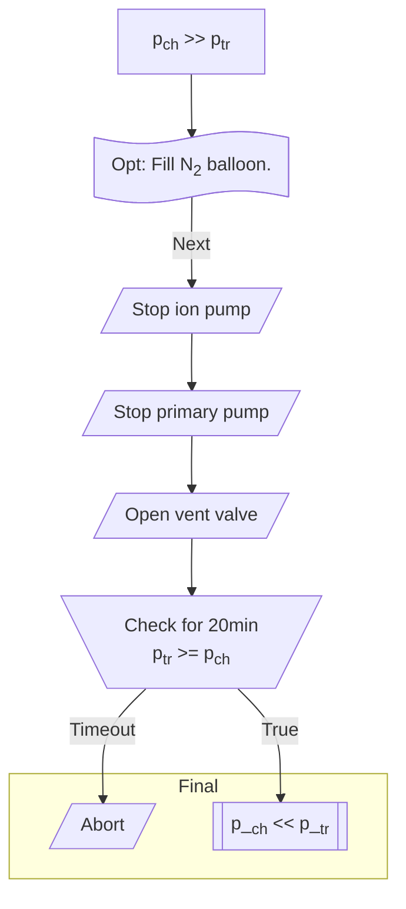

## Transfer a sample

The following workflow shows how a sample is transferred.
This workflow is fairly permissive,
such that even if the cryocooler has failed,
a user can get there sample out and keep it save.
The user is thus responsible to ensure
that the cooler is on and that the temperature of the sample holder
has reached the target temperature.

The timer to pump the gap and transfer should never be reached
and represents a maximum limit.
If the pressure is not good within these 10 minutes,
there might be a leak or something similar.

> [!NOTE]
> To ensure that the pressure is below the defined limit,
> we read it (default) 30 times in a row,
> which takes roughly 30 seconds.
> This value is configurable in the config file.

The detach check contains no timeout.
We will wait until the VCT is detached
and then close the transfer valve.
Note that the [hardware safety](./safety.md)
prevents the transfer valve from closing before the VCT valves are closed.

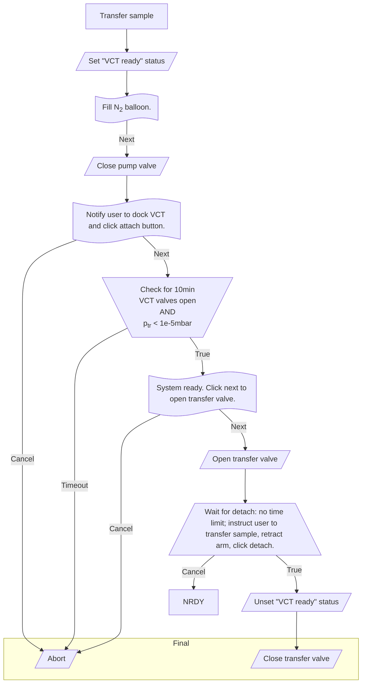
